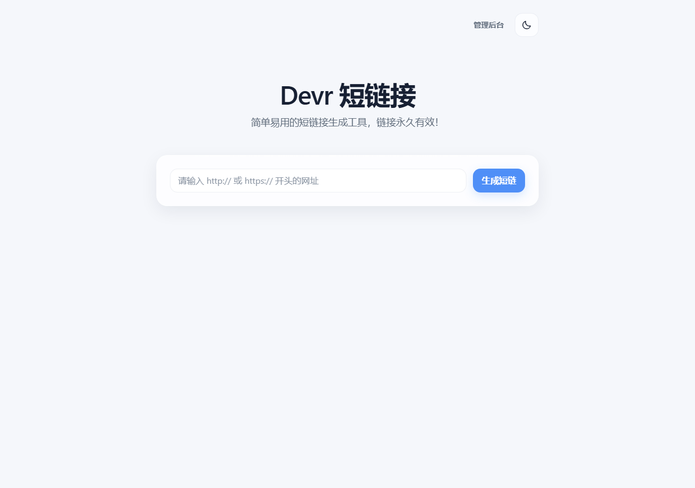
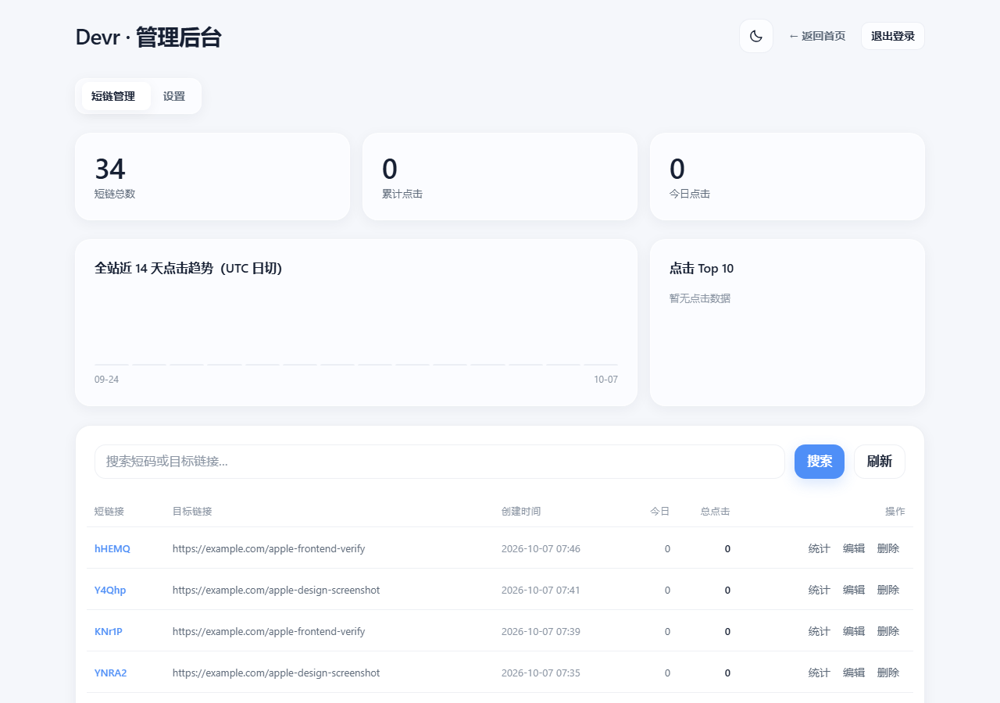
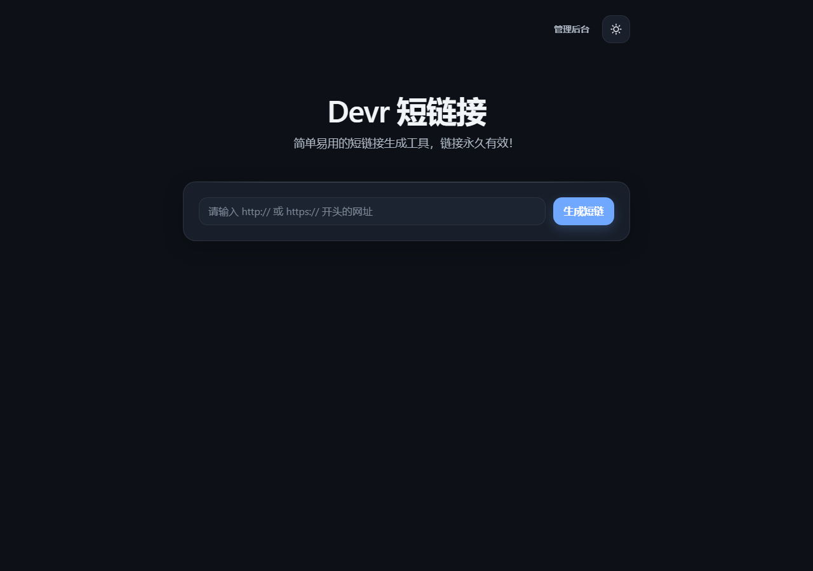
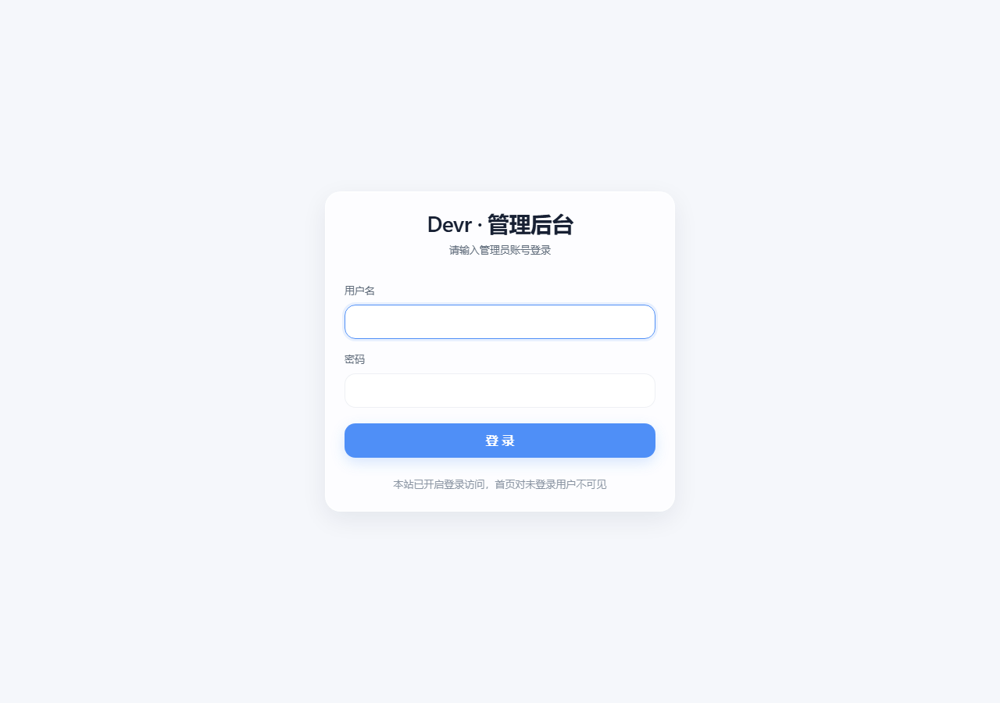
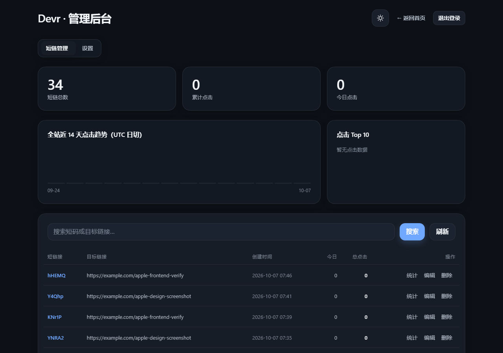

# Devr · Apple 设计语言前端

同一后端的第二套前端，按 Apple 设计原则（*Designing Fluid Interfaces* 等 WWDC 设计分享）
重写交互与视觉，**配色逐值沿用原前端**（155 项令牌断言零差异）。

## 运行

```bash
# 开发（端口 3100，API 代理到后端 3001）
npm run dev:apple

# 生产构建（输出到 dist-apple/）
npm run build:apple

# 校验配色令牌与旧前端逐值一致
npm run verify:tokens
```

旧前端仍可用 `npm run dev`（端口 3000）启动，两者共用同一后端与数据库，可并行对照。

## 目录

```
apple-frontend/
├── index.html            入口（首帧前应用主题，与旧前端共用 devr-theme 键）
├── vite.config.js        端口 3100 + API 代理
├── tailwind.config.js    布局工具类（配色走 CSS 变量，不在此定义）
├── postcss.config.js     显式锁定 tailwind 配置路径
├── verify-tokens.mjs     配色保真断言
└── src/
    ├── main.js           按路径挂载 HomeApp / AdminApp
    ├── styles/
    │   ├── tokens.css    设计令牌（配色逐值照搬旧系统）
    │   └── index.css     基础层 / 排版阶梯 / 材质 / 组件原语
    ├── motion/
    │   ├── spring.js     弹簧引擎（可中断、速度移交、子步进稳定积分）
    │   ├── project.js    动量投射 + 橡皮筋 + 提交判定
    │   └── gestures.js   Pointer 拖拽跟踪 + 速度历史
    ├── components/       按钮 / 分段控件 / Sheet / Toast / 开关 / 图表
    ├── home/             首页三件套
    └── admin/            登录 / 列表 / 设置 / 三个 Sheet
```

## 设计落地要点

**动效**：一律用弹簧而非固定时长过渡。参数用 Apple 的 damping + response
（默认阻尼 1.0 临界阻尼无过冲；仅手势带惯性时用 0.8 轻微回弹）。
三个关键能力：从中断处继续（读当前呈现值）、释放速度移交给动画（无接缝）、
动量投射决定落点。

**响应感**：按钮在 `pointerdown` 即反馈，不等 `click`。

**分段控件**：选中块是真实元素，由弹簧驱动滑动，可在滑动途中反向。

**弹窗 → Sheet**：可下滑关闭，1:1 跟手、越界橡皮筋、释放时用投影决定关闭或弹回；
点击遮罩空白处关闭（关闭处理挂在压暗层自身——它铺满整个遮罩区，事件不会冒泡到父容器）；
配焦点陷阱、焦点归还、body 滚动锁。

**材质**：按 thin/regular/thick/solid 分层表达层级，顶部高光边模拟光线；
压暗层与模糊层分离，动画只走 opacity（改 background alpha 会让 backdrop-filter 每帧重算，
实测掉到 18fps）。

**排版**：字号 + 字距 + 行高 三元组，大字号负字距、小字号正字距；间距用 rem 尊重用户字号设置。

**无障碍**：补齐 `role=alert`、`aria-live`、`role=tablist/tab/tabpanel`、图表语义；
支持 `prefers-reduced-motion`（位移降级为交叉淡入）、`prefers-reduced-transparency`、
`prefers-contrast`。

## 界面预览

| 首页（浅/深） | 生成结果 | 管理后台（浅/深） |
| --- | --- | --- |
|  |  |  |
|  | （登录页） |  |

更多截图见 [docs/apple-frontend/](../docs/apple-frontend/)：设置页（`apple-admin-settings-*`）
与统计 Sheet（`apple-stats-sheet-*`）。

## 与旧前端的差异

修正的问题：
- 首页错误提示取后端中文说明，而非 axios 的英文 `err.message`
- 搜索按钮有 loading 与防重复提交（旧版可重复点击）
- API Key 的重置/删除改用主题内确认框，不再用原生 `window.confirm`
- 密码修改按钮补 loading 态；统一 spinner（旧版统计弹窗用 `animate-pulse`）
- 登录页不预填管理员账号（旧版硬编码 `admin`）
- 深色模式下按钮投影、危险色 hover 跟随令牌（旧版硬编码浅色值）

## 注意

`postcss.config.js` 与 `vite.config.js` 都必须显式指定配置文件路径：
Vite/PostCSS/Tailwind 默认从**进程 cwd**（项目根目录）查找配置，
会命中旧前端的配置，导致新前端的类被当作未使用而清除。

设计系统自己的类（`.btn-*`、`.material-*`、`.type-*` 等）**不放在 `@layer components`**：
Tailwind 会按内容扫描剪裁该层内容，而组件里存在 `btn-${variant}` 这类拼接类名，
字面量不出现在源码中，会被整体清除。
